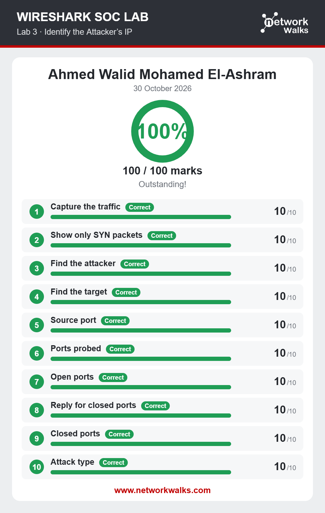
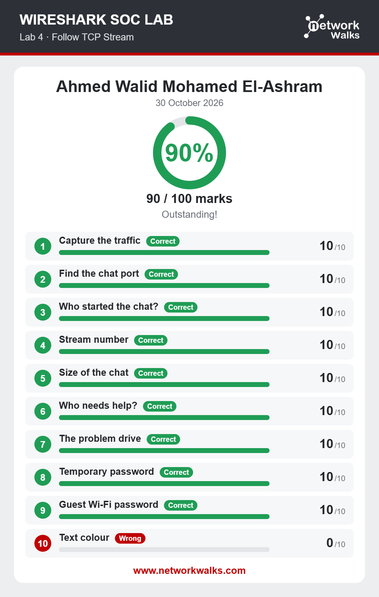
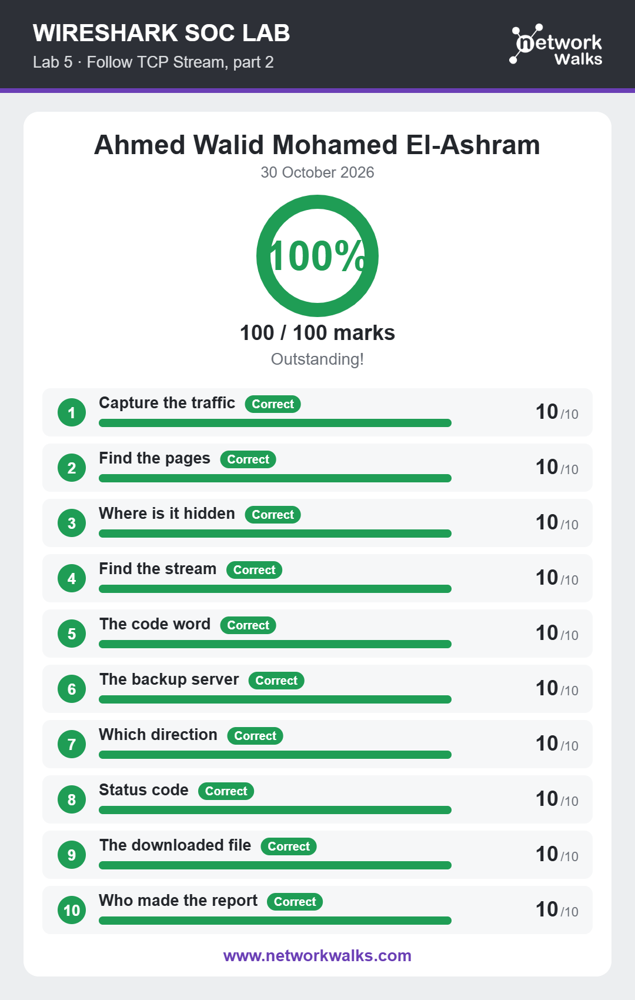
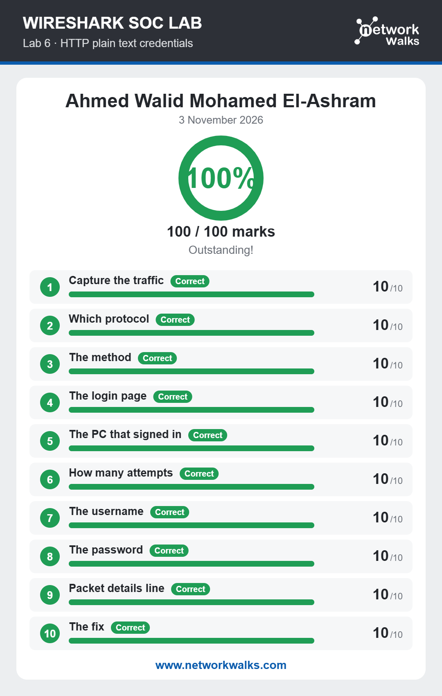
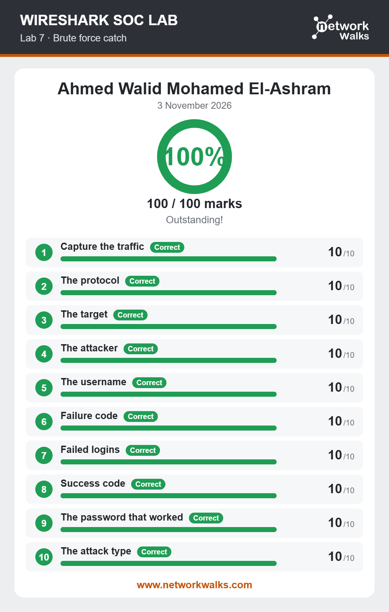
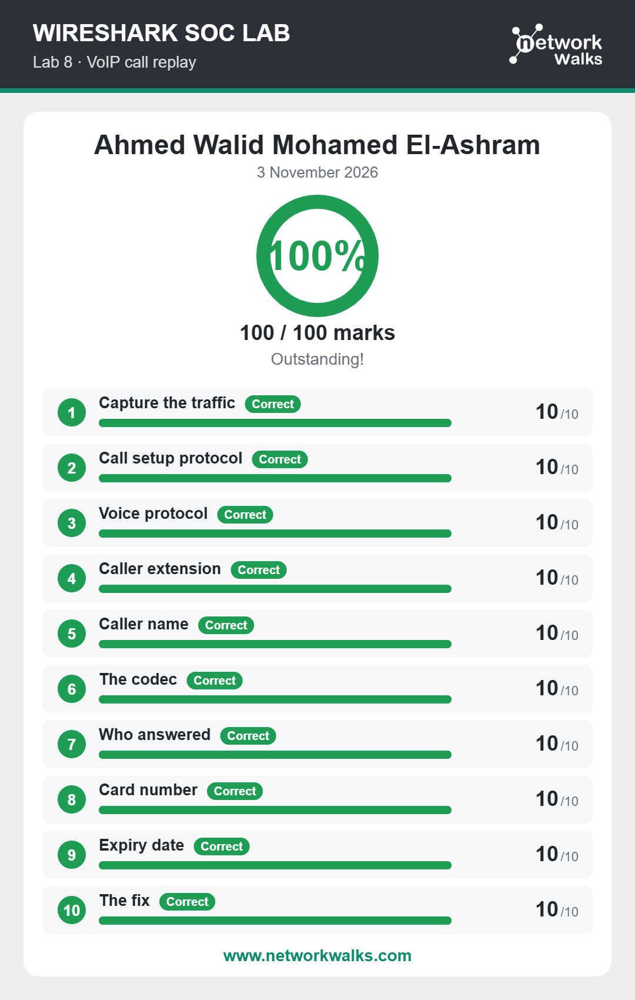

# Networkwalks SOC Project Module – Wireshark Labs (Extra)

**Author:** Ahmed Walid Mohamed El-Ashram

These are the extra Wireshark SOC labs from my Networkwalks internship. Each lab gives a packet capture and a set of questions to answer by analysing the traffic in Wireshark. The result card for each lab is included below.

## Results

| Lab | Topic | Date | Score |
|---|---|---|---|
| 3 | Identify the Attacker's IP | 30 Oct 2026 | 100/100 |
| 4 | Follow TCP Stream | 30 Oct 2026 | 90/100 |
| 5 | Follow TCP Stream, part 2 | 30 Oct 2026 | 100/100 |
| 6 | HTTP plain text credentials | 3 Nov 2026 | 100/100 |
| 7 | Brute force catch | 3 Nov 2026 | 100/100 |
| 8 | VoIP call replay | 3 Nov 2026 | 100/100 |

## Lab 3 – Identify the Attacker's IP

## Lab 4 – Follow TCP Stream

## Lab 5 – Follow TCP Stream, part 2

## Lab 6 – HTTP plain text credentials

## Lab 7 – Brute force catch

## Lab 8 – VoIP call replay

## Skills practised

- Capturing and filtering traffic in Wireshark
- Following TCP streams to read application data
- Spotting port scans and brute force attempts in packet captures
- Finding credentials sent in plain text over HTTP
- Reconstructing a VoIP call (SIP signalling and RTP audio)

Related repo: [Networkwalks-Cybersecurity-lab-setup-w1](https://github.com/ahmedwd22/Networkwalks-Cybersecurity-lab-setup-w1)
